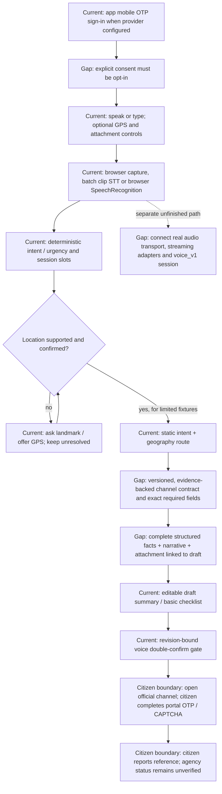

# End-to-end grievance flow: current state and gap map

**Audit date:** `2026-11-28` · **Audited base:** `voice/streaming-latency-v1` at `cffa1f371c6d94d18ba4d4c76223e42aa856773d` · **Working branch:** `voice/grievance-e2e-flow-v1`
**Purpose:** Define the narrowest honest end-to-end citizen flow, distinguish working code from scaffolds, and order the remaining work. This is a code/documentation audit, not a claim that the production flow has been exercised with a real citizen or filed with an agency.

## Decision in one sentence

NammaKural currently supports a **voice/text-to-reviewed-draft and citizen handoff prototype**; it does not yet prove statewide department/jurisdiction routing, real-time streaming through `voice_v1`, or government submission/receipt. First close one sourced, non-emergency Chennai GCC draft flow, and keep the citizen in control of the official portal handoff.

## One-flow pilot to finish first

Use one single-intent, non-emergency complaint: **a public streetlight is not working near Tower Park Back Side / Vth Avenue, Chennai, with the landmark and Ward 103 confirmed by the citizen**. Keep sparks, exposed live wires, and other electrical hazards out of this normal GCC path; route them to the safety response instead. This is a constrained fixture-backed pilot, not proof that the location resolver covers Chennai or Tamil Nadu. Existing examples are in [`backend/nlu.py`](../../backend/nlu.py) and [`state_packs/tn.json`](../../state_packs/tn.json).

The success outcome is a Tamil/Tanglish and editable text draft whose location, intended authority, field values, known limits and unresolved fields are explicit; the citizen reviews it, confirms twice by voice, and is handed off to the official channel to complete any portal verification and submit. The product must not say “filed” until a real, separately authorized filing integration returns an authoritative receipt. For this first vertical slice, actual government form submission is intentionally out of scope.

## Flow map

`Current` means a code path exists in this branch; it does not mean production quality or broad coverage. `Gap` means the end-to-end requirement is not yet implemented or evidenced. `Citizen boundary` is an intentional safety/access rule, not a missing feature.

## What exists today

1. **App access:** [`backend/citizen_accounts.py`](../../backend/citizen_accounts.py) implements provider-backed SMS mobile sign-in, an HttpOnly application cookie and private request history when configured. `NK_AUTH_REQUIRED=1` fails closed without the provider. The local prototype path in [`backend/state.py`](../../backend/state.py) instead exposes a synthetic OTP. That demo code is not identity verification and must not be enabled or represented as production sign-in.
2. **Important identity boundary:** the provider-backed code verifies control of a phone number; it does **not** verify that the number is Aadhaar-registered, authenticate the holder through UIDAI, or prove complaint eligibility. The repository explicitly excludes Aadhaar capture/UIDAI authentication in [`specs/010-citizen-access-and-operator-review/SPEC.md`](../../specs/010-citizen-access-and-operator-review/SPEC.md) and warns against collecting Aadhaar in [`AGENTS.md`](../../AGENTS.md). Keep the app’s phone OTP separate from any portal’s OTP. If an Aadhaar-linked eligibility check is ever essential, it needs an authorized UIDAI ecosystem integration, purpose/consent review, and separate security/legal approval; do not add Aadhaar numbers or try to automate UIDAI or government OTP flows.
3. **Voice and text intake:** [`frontend/src/pages/VoiceAgentPage.tsx`](../../frontend/src/pages/VoiceAgentPage.tsx) accepts typed text and browser microphone input. The configured Sarvam path records a complete WebM utterance and posts it to `/api/stt`; absent that provider, it tries browser `SpeechRecognition`. These are turn-based paths, not continuous inbound media streaming.
4. **NLU and workflow:** [`backend/agent_workflow.py`](../../backend/agent_workflow.py) applies deterministic privacy/safety gates and stores issue/location slots. [`backend/nlu.py`](../../backend/nlu.py) uses a limited issue regex/lexicon, a small set of known TN landmarks, area ambiguity prompts and fixture-based GPS matching. It is not a general department classifier, statewide geocoder, or authoritative ward-boundary service.
5. **Draft and channel:** [`backend/portal_bridge.py`](../../backend/portal_bridge.py) creates a single-destination draft and a non-submitting GCC preview packet. [`backend/civic_channels.py`](../../backend/civic_channels.py) supplies citizen-facing channel checklists. The public catalog [`data/civic/tn_public_catalog.json`](../../data/civic/tn_public_catalog.json) has richer evidence states, but the runtime draft builder does not consume that catalog as a validated per-channel schema. A GCC visible-control record is not proof of every required field, dynamic option, or server-side rule.
6. **Confirmation and handoff:** `/api/hitl/seal` binds approval to current draft revision/location/issue and requires two distinct confirmation turns in voice-double mode. Authenticated confirmation additionally requires a server-transcribed confirmation. The resulting handoff opens a public channel for the citizen; it does not submit a complaint. Saved agency references are explicitly citizen-reported, not agency-verified.
7. **Streaming scaffold:** [`backend/voice_v1`](../../backend/voice_v1) has provider-neutral contracts, turn/session policy and fake-adapter tests. Its own readiness/status docs say it is not wired to the browser audio path, a configured streaming ASR/TTS provider, production transport, or durable case store. The existing HTTP voice path and the V1 scaffold are two separate implementations today.

## Gaps to close, in priority order

| Priority | Gap | Evidence in the repository | What “done for the pilot” means |
|---|---|---|---|
| **P0 — trust and consent** | Consent starts effectively granted in the UI/server for an unseen session; local demo OTP is synthetic. Phone OTP is not Aadhaar identity proof. | `frontend/src/pages/VoiceAgentPage.tsx` initializes consent from session storage as granted; `backend/state.py` defaults missing consent to true and issues a known demo code; specs 009/010 define intended boundaries. | Make processing consent a clear opt-in before mic/text/GPS/attachments; production pilot requires provider-backed phone sign-in and `NK_AUTH_REQUIRED=1`; label the verification accurately as phone possession; never request/store Aadhaar. Test withdrawal and denial.
| **P0 — one authoritative channel contract** | The GCC catalog says `visible_controls`; requiredness, live street/category options and server validation are unknown. Preview metadata hardcodes a schema version and carries only a subset. | `data/civic/tn_public_catalog.json` route `gcc_pgrs` and its `unknown` list; `backend/portal_bridge.py` `GCC_SCHEMA_META`, category map and preview packet. | Manually re-check the chosen current official GCC path without submitting a test complaint. Record source URL/date, exact public fields and known limits, mark unknowns honestly, and bind each draft to that contract version. Do not turn `required: null` into “required” or “complete.”
| **P0 — structured one-flow intake** | Intent and location coverage are small and deterministic; the “department” is selected from static mappings. Distinguishing a dead public streetlight from an electrical distribution fault/hazard needs explicit policy. | `backend/nlu.py` `_ISSUE_PATTERNS`, `_VERIFIED_PLACES`, `SERVICE_CATALOG`; `backend/portal_bridge.py` destination selection. | For the single Tower Park case, confirm the citizen’s issue and landmark, fail closed on a conflicting/unknown place, explain why GCC PGRS is suggested, and ask only for missing facts. Hazard reports leave this path immediately. Keep one issue per draft for this slice.
| **P1 — draft completeness and user correction** | Current draft primarily stores a short utterance/summary and location; it does not implement all exact GCC values or a fully reviewed narrative/field contract. The UI has attachment inspection but the inspected file is not bound to the draft or handoff. | `backend/agent_workflow.py` `_capture_slots`; `backend/portal_bridge.py` `build_grievance_draft` / `build_gcc_preview_packet`; `backend/main.py` `/api/attachment/inspect`; `VoiceAgentPage.tsx` `handleFileUpload` and draft card. | Store the structured facts needed for the selected public contract, preserve the citizen’s full incident account in an editable draft, and show provenance/uncertainty. Let text correct speech. For an optional photo, validate type/size and explicit consent, associate it with this draft, and clearly state whether the receiving channel accepts it; otherwise do not imply it will be sent.
| **P1 — district, ward and department evidence** | 38 district homepages are listed, but the location database is only a few known landmarks; the public catalog explicitly treats homepage/discovery records as leads, not route coverage. | `state_packs/tn.json` `landmarks`; `data/civic/tn_public_catalog.json` `districts` and route evidence states; `specs/011-public-civic-catalog/SPEC.md`. | For the one pilot, provide evidence for district → civic body → zone → ward → street/landmark and show the match source. For every unsupported or ambiguous location, ask a clarification or give a truthful statewide referral; never infer a ward from a generic district page or coarse GPS.
| **P1 — one route vs multiple grievances** | `build_grievance_draft` chooses one destination. A single mixed account with sewage, drinking water and a sparking wire can lose nonurgent issues when the emergency is prioritized. | `docs/architecture/CIVIC_DRAFTER_PRODUCT_FIT.md` documents a synthetic mixed-issue replay that yielded only the electricity draft; `backend/portal_bridge.py` returns one draft. | Explicitly defer multi-intent splitting until the single-intent slice is safe. Then add issue-level records and separate drafts/confirmations per authority, preserving every issue through hazard handoff and evaluating the result.
| **P1 — real submission outcome and anti-spam semantics** | No government API/browser submission, agency receipt verification, or durable production cooldown exists. The current backend can open a link and store a citizen-reported reference; local cooldown entries include synthetic fixtures. | `backend/portal_bridge.py` sets `submitted: false`; `backend/state.py` has fixture request history; `backend/citizen_accounts.py` labels filing references `reported_by_citizen`; specs 009/010 exclude automatic filing. | Keep states distinct: draft ready → review approved → official channel opened → citizen reports filed → agency receipt verified (only when genuinely verified). For the first pilot, stop at the official handoff and clearly say that the citizen must complete portal OTP/CAPTCHA and submit. Do not claim OTP alone makes a request “legitimate.”
| **P1 — connect production streaming only after the draft path is coherent** | `voice_v1` orchestration is tested with fakes; no browser/session media route or real configured streaming adapters connect it. Current React path uses complete utterance capture and HTTP STT/workflow/TTS. | [`VOICE_V1_SCAFFOLD.md`](../../VOICE_V1_SCAFFOLD.md), [`VOICE_V1_REQUIREMENTS_STATUS.md`](../../VOICE_V1_REQUIREMENTS_STATUS.md), `backend/voice_v1/session.py`, `frontend/src/pages/VoiceAgentPage.tsx`. | Choose one path for the first live pilot. The existing HTTP half-duplex path is the smaller route to validate a complete grievance draft. Treat real bidirectional streaming as a separate integration gate: browser transport, audio decode/resample, VAD, streaming ASR partials, session adapter, incremental TTS playback, barge-in cancellation/queue flush, reconnect/failure tests.
| **P2 — trustworthy end-to-end latency** | Existing UI measures playback start after transcript submission and an estimated speech-end-to-playback interval; the V1 text harness intentionally reports `voice_ttfa_ms: null`. Provider first-byte and workflow durations are not audible TTFA. | `frontend/src/pages/VoiceAgentPage.tsx` `onPlayback`/turn timestamps; `backend/call_telemetry.py`; `backend/voice_v1/app.py` `/v1/test/turn` and `/v1/telemetry/playback`; telemetry pages. | Label measurements precisely, retain null for missing events, correlate each stage to one turn and client monotonic clock, and measure end-of-speech through first playable/audible output on real audio. Report p50/p90/p95/p99 by language, network/TURN, device, provider/model and warm/cold state. Do not claim a sub-500 ms voice SLO from text tests or provider TTFB.
| **P2 — evidence and rollout** | Unit/golden cases and UI checks exist, but they are not a live resident user evaluation or agency filing test. | `analytics/golden_cases.jsonl`, `analytics/eval_gate.py`, `tests/test_grievance_intake.py`, `docs/architecture/CIVIC_DRAFTER_PRODUCT_FIT.md`. | Extend the synthetic benchmark for the chosen case, location correction, negation, noisy names/numbers, mismatch, missing fields, attachment limits, consent denial, OTP/provider failure, duplicate/revision changes and two-confirm boundaries. Then run a small consented usability pilot; do not file real complaints as tests.

## Concrete implementation sequence

1. **Freeze the pilot contract:** one ordinary GCC streetlight case, one supported landmark/ward, one citizen-led channel; write down explicit non-goals (hazard, multi-issue splitting, statewide coverage, automatic portal entry/submission).
2. **Fix trust prerequisites:** explicit opt-in consent; require configured provider-backed phone sign-in in the deployed pilot; remove demo OTP affordances from any production configuration; state plainly that phone possession is not Aadhaar authentication.
3. **Review official GCC evidence:** inspect the current official form and update the public catalog with source date, observed field constraints and unknowns. No automated login, OTP or CAPTCHA. Resolve the static draft/preview mismatch before calling it ready.
4. **Complete the smallest structured draft:** one-question-at-a-time intake for issue, confirmed landmark/ward and required incident facts; editable bilingual narrative; channel-specific checklist with unknown fields visible; text correction path. Keep optional attachment handling consented and linked or disable it for this slice.
5. **Make the handoff honest:** after reading back the issue/location/recipient and receiving two distinct spoken confirmations, offer the official route plus copyable fields. The citizen performs portal verification and submission. Store any reference only as “reported by citizen.”
6. **Close the real voice loop:** build/serve the React app and run a human Tamil/Tanglish mic walkthrough, verify interruptions and fallback, and capture failures. Then decide whether the existing HTTP path meets the pilot or whether to integrate the V1 streaming architecture.
7. **Expand only from measured evidence:** add authoritative geography/channel contracts, then multiple departments and multi-issue splitting, with abstention and failure evaluation before each coverage expansion.

## Latency interpretation for this branch

- **`workflow_ms` / `call.workflow.latency_ms`:** server-side civic workflow duration; it does not include microphone capture, waiting for the user to finish, ASR, or browser audio playback.
- **`post_transcript_ms`:** browser interval beginning just before the workflow request and ending at the audio element's `onplaying` callback. It is not full speech-to-response latency and `onplaying` is not independent proof of audible output.
- **`speech_to_playback_ms`:** browser-estimated end-of-speech to the same playback callback. This is closer to a user-perceived interval but still depends on browser event semantics and current half-duplex path.
- **`stt.sarvam_saaras` / `browser_stt_ms`:** STT request duration when available; absent on browser-native recognition or nonconfigured provider paths.
- **`tts.sarvam_stream_ttfb`:** backend time to the first provider audio chunk, not to browser playback.
- **`backend/voice_v1` text harness:** deliberately returns `voice_ttfa_ms: null`; its sample playback-ack test checks client-supplied timestamp arithmetic, not a real voice path.

Use the dedicated call telemetry definitions in [`backend/call_telemetry.py`](../../backend/call_telemetry.py) and UI labels in [`frontend/src/pages/TelemetryPage.tsx`](../../frontend/src/pages/TelemetryPage.tsx). Keep distinct metrics separate; do not collapse workflow, provider, post-transcript, estimated speech-to-playback and real audible TTFA into one “latency” number.

## Markdown/documentation map

- [`AGENTS.md`](../../AGENTS.md) sets project invariants and the spec-driven Markdown rules.
- [`CONTEXT.md`](../../CONTEXT.md) is the short active-state handoff; [`TODO.md`](../../TODO.md) tracks current outcomes; [`LOG.md`](../../LOG.md) is append-only history.
- [`specs/INDEX.md`](../../specs/INDEX.md) is the spec navigation table; each subsystem spec owns scope, non-goals, invariants and acceptance clauses.
- [`VOICE_V1_SCAFFOLD.md`](../../VOICE_V1_SCAFFOLD.md) and [`VOICE_V1_REQUIREMENTS_STATUS.md`](../../VOICE_V1_REQUIREMENTS_STATUS.md) explain that streaming contracts/tests are not a live provider/media integration.
- `docs/architecture/` contains product, privacy, voice and deployment decisions; `data/civic/` and `research/civic/` preserve source evidence and audit material. Do not treat catalog discovery records or a spec status of `done` as proof of production deployment or portal acceptance.
